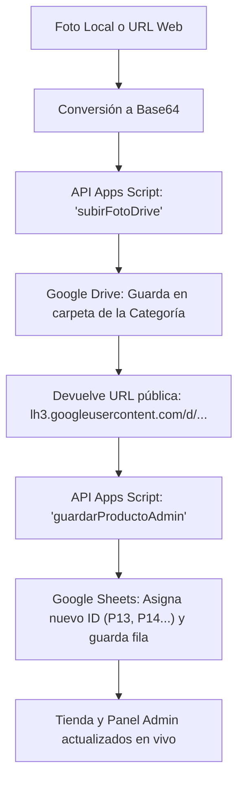

# 📖 Manual y Guía Rápida: Cómo Subir Productos Automáticamente

Este documento explica cómo funciona el flujo automatizado para subir productos con sus imágenes directamente a **Google Drive** y sincronizarlos con **Google Sheets** y el **Catálogo en Vivo**.

---

## 🚀 1. Uso Rápido con el Script `subir_producto.js`

Puedes subir cualquier producto en segundos ejecutando una sola línea en la terminal:

### Desde Node.js:
```bash
node subir_producto.js --imagen "foto.jpg" --nombre "Zapatos Deportivos Pro" --categoria "Zapatos" --precio 38.00 --stock 20
```

### Desde PowerShell:
```powershell
.\subir_producto.ps1 -Imagen "foto.jpg" -Nombre "Zapatos Deportivos Pro" -Categoria "Zapatos" -Precio 38.00 -Stock 20
```

---

## 📋 2. Parámetros Disponibles

| Parámetro | Obligatorio | Descripción | Ejemplo |
|---|---|---|---|
| `--nombre` | **Sí** | Nombre comercial del producto | `"Camiseta DryFit Sport"` |
| `--precio` | **Sí** | Precio numérico en dólares | `25.50` |
| `--imagen` | No | Ruta a archivo local (`.jpg`, `.png`, `.webp`) o enlace web | `"C:\fotos\zapato.jpg"` o `https://...` |
| `--categoria` | No | Carpeta de Drive y categoría (por defecto: `Zapatos`) | `"Deportes"`, `"Zapatos"`, `"Ropa Mujer"` |
| `--subcategoria` | No | Etiqueta adicional de sección | `"Fitness"`, `"Casual"`, `"Repuestos"` |
| `--genero` | No | Público objetivo (por defecto: `Unisex`) | `"Unisex"`, `"Hombre"`, `"Mujer"`, `"Niños"` |
| `--stock` | No | Cantidad de unidades disponibles (por defecto: `10`) | `25` |
| `--estado` | No | Estado en el catálogo (por defecto: `Disponible`) | `"Disponible"`, `"Agotado"` |
| `--descripcion` | No | Texto descriptivo del producto | `"Material transpirable..."` |
| `--clave` | No | Clave de administración (por defecto: `admin2026`) | `"admin2026"` |

---

## 🔄 3. ¿Qué hace el script por debajo? (Flujo End-to-End)



1. **Lectura de la Imagen:**
   - Si le pasas un archivo en tu computadora (ej: `foto.jpg`), lo lee y lo codifica en formato seguro Base64.
   - Si le pasas un enlace web (`http://...`), lo descarga primero automáticamente y lo codifica.
2. **Subida a Google Drive:**
   - Envía la imagen al Apps Script (`accion: 'subirFotoDrive'`).
   - El script ubica la subcarpeta de la categoría en tu unidad de Google Drive (`1. Zapatos y Calzado`, `2. Deportes y Fitness`, etc.) y guarda el archivo allí.
   - Genera un enlace directo optimizado de alta velocidad (`https://lh3.googleusercontent.com/d/ID_ARCHIVO`) que no requiere permisos ni inicios de sesión de Google.
3. **Registro en Google Sheets:**
   - Guarda el nuevo producto con la acción `guardarProductoAdmin`.
   - Asigna el próximo ID numérico consecutivo (`P01`, `P02` ... `P14`).
   - La hoja de cálculo **`Productos`** queda actualizada al instante.
4. **Disponibilidad Inmediata:**
   - La tienda [yolix-arch.github.io](https://yolix-arch.github.io/) y el panel de administración [admin.html](https://yolix-arch.github.io/admin.html) muestran el nuevo producto inmediatamente sin necesidad de compilar ni hacer cambios manuales.

---

## 🤖 4. Cómo pedirle al Asistente / Subagente que suba un producto

Cuando quieras subir nuevos productos en el chat, solo dile al asistente:

> *"Sube un nuevo producto: Zapatos Casuales Urbanos, categoría Zapatos, precio 30, stock 15, y genera la imagen con el subagente."*

El asistente ejecutará internamente:
1. El subagente `image-generator` para crear la foto con calidad de estudio.
2. El script `subir_producto.js` pasándole la ruta de la imagen creada.
3. Te entregará el ID generado y el enlace directo en Google Drive.

---

## 📁 5. Categorías y Carpetas de Google Drive

| Nombre en Script / Tienda | Carpeta en tu Google Drive |
|---|---|
| `Zapatos` | `1. Zapatos y Calzado` |
| `Deportes` | `2. Deportes y Fitness` |
| `Ropa Mujer` | `3. Ropa para Mujer` |
| `Ropa Hombre` | `2. Ropa y Moda` |
| `Ropa Niños` | `4. Niños y Bebes` |
| `Bebés` | `4. Niños y Bebes` |
| `Carros` | `5. Carros y Repuestos` |
| `Accesorios` | `6. Accesorios Generales` |
